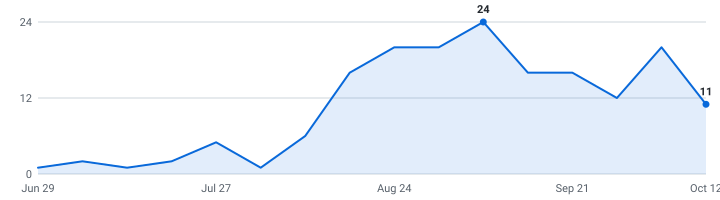

# Indian Tech Roles (2026 Graduates)

   

A self-updating engine that tracks tech roles and internships for 2026 graduates so you don't have to. Instead of refreshing a dozen career pages by hand, it reads company hiring feeds directly and keeps one live list, newest roles on top, refreshed automatically throughout the day.

**48 open roles · 17 new this week · 5,502 companies tracked · updated Oct 25, 2026 at 00:01 UTC**

**⭐Star this repo⭐** to save it and get updates when new roles are added.

**Live:** [dashboard](https://smeerdev.github.io/Job-finder-agent/) · [RSS feed](https://smeerdev.github.io/Job-finder-agent/feed.xml) (instant alerts in any RSS app) · [JSON API](https://smeerdev.github.io/Job-finder-agent/api/jobs.json)

**🔔 New roles in your inbox:** [subscribe by email](https://smeerdev.github.io/Job-finder-agent/#subscribe) - one email a day, only when new internships actually appeared, one-click unsubscribe. (Prefer RSS-to-email? [Feedrabbit works too](https://feedrabbit.com/subscriptions/new?url=https%3A%2F%2Fraw.githubusercontent.com%2FSmeerdev%2FJob-finder-agent%2Fmain%2Fdocs%2Ffeed.xml).)
---

## 2026 Graduates (International)  (48 open)

| Company | Role | Category | Pay & Specs | Location | Posted | Apply |
|---|---|---|---|---|---|---|
| Honeywell | Intern Bachelors AI ~ 🆕 | Data & ML/AI | — | Bengaluru, Karnataka, India | Oct 24, 2026 | [Apply](https://ibqbjb.fa.ocs.oraclecloud.com/hcmUI/CandidateExperience/en/sites/CX_1/job/160494) |
| Honeywell | Intern Bachelors Software Eng ~ 🆕 | Software | B.Tech/BS | Bengaluru, Karnataka, India | Oct 24, 2026 | [Apply](https://ibqbjb.fa.ocs.oraclecloud.com/hcmUI/CandidateExperience/en/sites/CX_1/job/160495) |
| DTCC | Software Engineering Associate ~ 🆕 | Software | B.Tech/BS | Hyderabad, India | Oct 23, 2026 | [Apply](https://ebxr.fa.us2.oraclecloud.com/hcmUI/CandidateExperience/en/sites/CX_1/job/215060) |
| agilon health | Associate Software Engineer ~ 🆕 | Software | 2+ Yrs B.Tech/BS | India_Gurgaon | Oct 23, 2026 | [Apply](https://agilonhealth.wd1.myworkdayjobs.com/External/job/India_Gurgaon/Senior-Software-Engineer_R003568) |
| Marvell | Intern, Software Engineer - Bachelor's Degree ~ 🆕 | Software | B.Tech/BS | Hyderabad | Oct 23, 2026 | [Apply](https://marvell.wd1.myworkdayjobs.com/MarvellCareers2/job/Hyderabad/Intern--Software-Engineer---Bachelor-s-Degree_2604624) |
| Marvell | Intern, Software QA Engineer - Bachelor's Degree ~ 🆕 | Software | B.Tech/BS | Hyderabad | Oct 23, 2026 | [Apply](https://marvell.wd1.myworkdayjobs.com/MarvellCareers2/job/Hyderabad/Intern--Software-QA-Engineer---Bachelor-s-Degree_2604250) |
| The Hartford | IND Associate Software Engineer -  Red Team Engineer ~ 🆕 | Software | B.Tech/BS | India GCC-Puppalaguda Village | Oct 23, 2026 | [Apply](https://thehartford.wd5.myworkdayjobs.com/Careers_External/job/India-GCC-Puppalaguda-Village/IND-Associate-Software-Engineer----Red-Team-Engineer_R2627341) |
| Valeo | AI - Intern 🆕 | Data & ML/AI | B.Tech/BS | Chennai | Oct 23, 2026 | [Apply](https://valeo.wd3.myworkdayjobs.com/valeo_jobs/job/Chennai/AI---Intern_REQ2026080851) |
| OpenSesame | AI Product Builder Intern ~ | Data & ML/AI | $25/hr B.Tech/BS | Remote | Oct 22, 2026 | [Apply](https://boards.greenhouse.io/opensesame/jobs/8313424?gh_jid=8313424) |
| Marvell | Software Engineer Intern - Master's Degree ~ | Software | M.Tech/MS | Bangalore | Oct 22, 2026 | [Apply](https://marvell.wd1.myworkdayjobs.com/MarvellCareers2/job/Bangalore/Software-Engineer-Intern---Master-s-Degree_2603868) |
| Marvell | Software Validation Intern - Master's Degree ~ | Software | B.Tech/BS | Bangalore | Oct 22, 2026 | [Apply](https://marvell.wd1.myworkdayjobs.com/MarvellCareers2/job/Bangalore/Software-Validation-Intern---Master-s-Degree_2603870) |
| TriNet | Associate Data Analyst ~ | Data & ML/AI | 2+ Yrs B.Tech/BS | Hyderabad, Telangana, India | Oct 22, 2026 | [Apply](https://fa-etgw-saasfaprod1.fa.ocs.oraclecloud.com/hcmUI/CandidateExperience/en/sites/CX_1/job/3004251) |
| Coinbase | Software Engineer Intern ~ | Software | B.Tech/BS | Hybrid - Singapore | Oct 21, 2026 | [Apply](https://www.coinbase.com/careers/positions/8175873?gh_jid=8175873) |
| Revvity | AI Applications DevOps Intern ~ | Data & ML/AI | B.Tech/BS | Mumbai | Oct 21, 2026 | [Apply](https://revvity.wd103.myworkdayjobs.com/External/job/Mumbai/AI-Applications-DevOps-Intern_JR-045766) |
| Revvity | Full-Stack AI Engineering Intern ~ | Data & ML/AI | B.Tech/BS | Mumbai | Oct 21, 2026 | [Apply](https://revvity.wd103.myworkdayjobs.com/External/job/Mumbai/Full-Stack-AI-Engineering-Intern_JR-045768) |
| Quora | Full Stack Software Engineer, New Grad - Quora (Remote) | Software | 0-1 Yr B.Tech/BS | Remote - Multiple Locations | Oct 20, 2026 | [Apply](https://jobs.ashbyhq.com/quora/5494e6a1-a973-46af-b9f3-57208eb91b52) |
| Priceline | Associate Software Engineer ~ | Software | 2+ Yrs B.Tech/BS | Mumbai | Oct 19, 2026 | [Apply](https://priceline.wd1.myworkdayjobs.com/Priceline/job/Mumbai/Associate-Software-Engineer_R5880) |
| iSpot.tv | Associate Data Analyst ~ | Data & ML/AI | $76.787k–$92.916k/yr B.Tech/BS | Remote | Oct 16, 2026 | [Apply](https://job-boards.greenhouse.io/ispottv/jobs/4742654005) |
| Quora | Machine Learning Engineer, New Grad - Quora (Remote) ~ | Data & ML/AI | 0-1 Yr B.Tech/BS | Remote - Multiple Locations | Oct 15, 2026 | [Apply](https://jobs.ashbyhq.com/quora/40659fe7-545e-4b08-b6d7-2567b18b9ed3) |
| Marvell | Generative AI Forward Deployed Engineer Intern- Master's Degree ~ | Data & ML/AI | B.Tech/BS | Bangalore | Oct 15, 2026 | [Apply](https://marvell.wd1.myworkdayjobs.com/MarvellCareers2/job/Bangalore/Generative-AI-Forward-Deployed-Engineer-Intern--Master-s-Degree_2604231) |
| Cloudflare | Infrastructure Business Operations Associate ~ | Software | B.Tech/BS | Hybrid | Oct 14, 2026 | [Apply](https://boards.greenhouse.io/cloudflare/jobs/8278383?gh_jid=8278383) |
| Rolls-Royce | Integrated Control Systems Engineer Intern (Software) ~ | Software | B.Tech/BS | Indianapolis | Oct 13, 2026 | [Apply](https://rollsroyce.wd3.myworkdayjobs.com/Intern_Graduate/job/Indianapolis/Integrated-Control-Systems-Engineer-Intern--Software-_JR6161452) |
| Oaktree Capital Management | Associate - Software Engineer Investment Systems and Integration (.Net Engineer) ~ | Software | B.Tech/BS | Hyderabad | Oct 12, 2026 | [Apply](https://oaktree.wd1.myworkdayjobs.com/oaktree/job/Hyderabad/Associate---Software-Engineer-Investment-Systems-and-Integration--Net-Engineer-_2026-533) |
| GuidePoint Security | AI & Data Science Intern - GPSU/NE ~ | Data & ML/AI | $20/hr B.Tech/BS | Remote | Oct 08, 2026 | [Apply](https://boards.greenhouse.io/guidepointsecurity/jobs/6218650004?gh_jid=6218650004) |
| GuidePoint Security | Cloud Infrastructure Intern - GPSU/NE ~ | Software | $20/hr B.Tech/BS | Remote | Oct 08, 2026 | [Apply](https://boards.greenhouse.io/guidepointsecurity/jobs/6218667004?gh_jid=6218667004) |
| SailPoint | Software Engineer Intern - Platform Engines ~ | Software | B.Tech/BS | Remote (United Kingdom) | Oct 07, 2026 | [Apply](https://sailpoint.wd1.myworkdayjobs.com/SailPoint/job/Remote-United-Kingdom/Software-Engineer-Intern---Platform-Engines_R014164) |
| Barnes & Thornburg | Data Privacy and AI Associate ~ | Data & ML/AI | B.Tech/BS | Indianapolis | Oct 05, 2026 | [Apply](https://jobs.ashbyhq.com/barnes/fd87b2c0-dec0-4d54-8543-da70dd28a802) |
| Mitel Networks | R&D Intern (student) - iOS development ~ | Software | B.Tech/BS | Curitiba (Remote) | Oct 05, 2026 | [Apply](https://mitel.wd3.myworkdayjobs.com/mitelcareers/job/Curitiba-Remote/R-D-Intern--student----iOS-development_R013162) |
| TriNet | Associate Data Scientist ~ | Data & ML/AI | B.Tech/BS | Hyderabad, Telangana, India | Oct 05, 2026 | [Apply](https://fa-etgw-saasfaprod1.fa.ocs.oraclecloud.com/hcmUI/CandidateExperience/en/sites/CX_1/job/3004076) |
| PTC | Associate Software Analyst ~ | Software | B.Tech/BS | Pune, India | Sep 29, 2026 | [Apply](https://ptc.wd1.myworkdayjobs.com/ptc/job/Pune-India/Associate-Software-Analyst_JR112163) |
| Quora | Software Engineer New Grad, Machine Learning Platform - Quora (Remote) | Data & ML/AI | 0-1 Yr B.Tech/BS | Remote - Multiple Locations | Sep 25, 2026 | [Apply](https://jobs.ashbyhq.com/quora/cf34f80e-fe5c-454d-bc9a-4c59993ffda0) |
| DTCC | Software Engineering Associate (Java with AWS) ~ | Software | B.Tech/BS | Hyderabad, India | Sep 17, 2026 | [Apply](https://ebxr.fa.us2.oraclecloud.com/hcmUI/CandidateExperience/en/sites/CX_1/job/214668) |
| Ancestry | Data Science - AI Document Understanding, Co-op ~ | Data & ML/AI | B.Tech/BS | Remote | Sep 16, 2026 | [Apply](https://ancestry.wd501.myworkdayjobs.com/Careers/job/Remote/Data-Science---AI-Document-Understanding--Co-op_R003449) |
| Ancestry | AI Discovery Co-Op - Agentic Personalization ~ | Data & ML/AI | B.Tech/BS | Remote | Sep 03, 2026 | [Apply](https://ancestry.wd501.myworkdayjobs.com/Careers/job/Remote/Applied-AI-Science-Co-op---Embedding-models-and-Personalization_R003442) |
| Oaktree Capital Management | Associate, ServiceNow Developer ~ | Software | — | Hyderabad | Aug 17, 2026 | [Apply](https://oaktree.wd1.myworkdayjobs.com/oaktree/job/Hyderabad/Associate--ServiceNow-Developer_2026-85) |
| Ancestry | Machine Learning Engineer, Co-op ~ | Data & ML/AI | B.Tech/BS | Remote | Aug 11, 2026 | [Apply](https://ancestry.wd501.myworkdayjobs.com/Careers/job/Remote/Machine-Learning-Engineer--Co-op_R003377) |
| Oaktree Capital Management | Associate, Workday Financial Developer (L3) ~ | Software | — | Hyderabad | Aug 04, 2026 | [Apply](https://oaktree.wd1.myworkdayjobs.com/oaktree/job/Hyderabad/Associate--Workday-Financials-Developer--L2-_2026-236) |
| ReliaQuest | Associate Software Engineer ~ | Software | 0-1 Yr | Pune India Office | Jul 15, 2026 | [Apply](https://reliaquest.wd5.myworkdayjobs.com/ReliaQuest_Careers/job/Pune-India-Office/Associate-Software-Engineer_R15032) |
| Oaktree Capital Management | Associate - Workday reporting developer ~ | Software | B.Tech/BS | Hyderabad | Jun 30, 2026 | [Apply](https://oaktree.wd1.myworkdayjobs.com/oaktree/job/Hyderabad/Associate---Workday-reporting-developer_2026-337) |
| Valeo | Intern - AI ~ | Data & ML/AI | — | Chennai | Aug 06, 2025 | [Apply](https://valeo.wd3.myworkdayjobs.com/valeo_jobs/job/Chennai/Intern---AI_REQ2025061319) |
| SSTPath | Angular Developer - Intern ~ | Software | — | Bangalore,Hyderabad | — | [Apply](https://www.instahyre.com/job-447008-angular-developer-intern-internship-at-sstpath-bangalore-hyderabad/) |
| AlgoUniversity | Teaching & Software Engineering Intern ~ | Software | — | Bangalore | — | [Apply](https://www.instahyre.com/job-444755-teaching-software-engineering-intern-internship-at-algouniversity-2-bangalore/) |
| Pradrix | AI / ML Engineer - Intern ~ | Data & ML/AI | — | Work From Home | — | [Apply](https://www.instahyre.com/job-445445-ai-ml-engineer-intern-internship-at-pradrix-work-from-home/) |
| Zetwerk | DevOps Engineer - Intern ~ | Software | — | Bangalore | — | [Apply](https://www.instahyre.com/job-444501-devops-engineer-intern-internship-at-zetwerk-bangalore/) |
| Gameberry Labs | Gen AI Designer - Intern ~ | Data & ML/AI | — | Bangalore | — | [Apply](https://www.instahyre.com/job-443500-gen-ai-designer-intern-internship-at-gameberry-labs-bangalore/) |
| Aitainment | Data Analyst - Intern ~ | Data & ML/AI | — | Bangalore | — | [Apply](https://www.instahyre.com/job-442949-data-analyst-intern-internship-at-aitainment-bangalore/) |
| PagarBook | Full Stack Development Intern ~ | Software | — | Bangalore | — | [Apply](https://www.instahyre.com/job-439220-full-stack-development-intern-internship-at-pagarbook-bangalore/) |
| Oneture Technologies | AI / ML Intern ~ | Data & ML/AI | — | Mumbai | — | [Apply](https://www.instahyre.com/job-390123-ai-ml-intern-at-oneture-technologies-mumbai/) |

_~ = the title doesn't state a year; bucketed here from its posting date (45 of 48)._

## What this is

This is an engine, not a hand-kept list. It polls company career feeds several times a day, finds the internships, removes duplicates, and rebuilds this page on its own. Every link comes straight from the source, so it's real and current, not a stale list someone forgot to update (speed matters).

## What makes this different

- **📅 [Drop Radar](#drop-radar)** - the only list that shows **what's coming**: each marquee company's typical opening window, then confirmed with the real drop date the moment the engine catches it live.
- **Real posted dates on every role** - pulled from each job portal itself, so newest-first actually means newest.
- **Skill tags + pay, extracted** - every posting's text is scanned for the stack it wants (Python, C++, PyTorch, ...) and the pay it states - searchable on the [dashboard](https://smeerdev.github.io/Job-finder-agent/), included in the CSV and API.
- **Alerts your way** - [email digests](https://smeerdev.github.io/Job-finder-agent/#subscribe), [RSS](https://smeerdev.github.io/Job-finder-agent/feed.xml), or Discord - plus a [live dashboard](https://smeerdev.github.io/Job-finder-agent/) with search and custom filters.
- **An engine, not a spreadsheet** - polled every hour across multiple ATS platforms with full source in this repo.

## Scope

- **Roles:** Software Engineering, Data Science & Machine Learning (and closely related technical internships)
- **Region:** United States
- **Cycles:** 2026 Graduates

## About

I built this engine to automate tracking for top-tier tech internships across India and globally remote roles. Use it to spot roles early and apply before they fill up - being first genuinely helps.

## How to use

- Roles are grouped by cycle - **newest posting on top, oldest at the bottom.**
- The **Posted** column is the date the company published the role.
- **Flags:** 🆕 = spotted in the last 48 hours.
- Track your applications with [`data/internships.csv`](data/internships.csv) (opens in Excel / Google Sheets).
- Missing a company? Adding one takes a single line, see [CONTRIBUTING.md](CONTRIBUTING.md).

---

## 📅 Drop Radar — when companies usually post for 2026 Graduates

Stop refreshing career pages. Every date here is **real or verified** — no third-party list. 🎯 = the engine **saw the drop itself** from the company's own careers API; the rest are hand-checked typical opening windows for marquee names. ✅ = already live in the list above.

> **Heads up:** companies trend *earlier* every cycle, and "~Aug" is a month, not a day. Treat "expected" as when to **start watching**, and "rolling" companies as worth checking year-round.

| Company | Typical opening | Expected this cycle | Status |
|---|---|---|---|
| Adobe | — | — | ⏳ waiting |
| Airbnb | — | — | ⏳ waiting |
| Akuna Capital | — | — | ⏳ waiting |
| Amazon | — | — | ⏳ waiting |
| Bloomberg | — | — | ⏳ waiting |
| Citadel | — | — | ⏳ waiting |
| Citadel Securities | — | — | ⏳ waiting |
| Coinbase | — | — | ⏳ waiting |
| D.E. Shaw | — | — | ⏳ waiting |
| Databricks | — | — | ⏳ waiting |
| DoorDash | — | — | ⏳ waiting |
| Dropbox | — | — | ⏳ waiting |
| DRW | — | — | ⏳ waiting |
| Five Rings | — | — | ⏳ waiting |
| Google | — | — | ⏳ waiting |
| Hudson River Trading | — | — | ⏳ waiting |
| Jane Street | — | — | ⏳ waiting |
| Meta | — | — | ⏳ waiting |
| Optiver | — | — | ⏳ waiting |
| Pinterest | — | — | ⏳ waiting |
| Plaid | — | — | ⏳ waiting |
| Point72 | — | — | ⏳ waiting |
| Ramp | — | — | ⏳ waiting |
| Robinhood | — | — | ⏳ waiting |
| Roblox | — | — | ⏳ waiting |
| Salesforce | — | — | ⏳ waiting |
| SIG | — | — | ⏳ waiting |
| Snowflake | — | — | ⏳ waiting |
| Stripe | — | — | ⏳ waiting |
| Tower Research Capital | — | — | ⏳ waiting |

_47 companies on the [full radar](https://smeerdev.github.io/Job-finder-agent/#radar). **5** dated from our own live observations 🎯 (this grows every cycle). "~Aug" = hand-verified typical month, not a promise of the day; "rolling" = posts year-round; "waiting" = not seen in our tracked feeds yet, not a guarantee it isn't out somewhere else._

<strong>Recently closed</strong> — 40 roles taken down in the last 14 days

| Company | Role | Cycle | Closed |
|---|---|---|---|
| Honeywell | Intern Bachelors AI | 2026 Graduates | 2026-10-23 |
| WSP | Associate - Structures Transport & Infrastructure, SG | 2026 Graduates | 2026-10-23 |
| Honeywell | Intern Bachelors Software Eng | 2026 Graduates | 2026-10-23 |
| Honeywell | Intern Bachelors AI Eng | 2026 Graduates | 2026-10-23 |
| Marvell | Intern, Software Engineer | 2026 Graduates | 2026-10-23 |
| DTCC | Software Development Engineering in Test Associate | 2026 Graduates | 2026-10-23 |
| Lean TECHniques | Software Engineer Intern - Hybrid | 2026 Graduates | 2026-10-23 |
| Marvell | Intern, Software QA Engineer Bachelor's Degree | 2026 Graduates | 2026-10-22 |
| DTCC | Software Developers in Test Associate | 2026 Graduates | 2026-10-22 |
| Thoughtworks | Software Procurement Intern | 2026 Graduates | 2026-10-22 |
| Honeywell | Intern Bachelors Embedded Eng | 2026 Graduates | 2026-10-22 |
| DTCC | Software Developers in Test Associate | 2026 Graduates | 2026-10-22 |
| Qumulo | Software Development Engineer (New Grad / Entry Level) | 2026 Graduates | 2026-10-22 |
| AtkinsRéalis | Data Science Intern | 2026 Graduates | 2026-10-21 |
| Autodesk | Intern, Research - Context and Knowledge Systems for AI | 2026 Graduates | 2026-10-21 |
| Marsh | AI Engineer Intern | 2026 Graduates | 2026-10-20 |
| Global Payments | Associate Client Server Software Analyst | 2026 Graduates | 2026-10-20 |
| Honeywell | Intern Bachelors Software Eng | 2026 Graduates | 2026-10-20 |
| DTCC | Software Engineering Associate | 2026 Graduates | 2026-10-20 |
| Airbus | Data Science Intern | 2026 Graduates | 2026-10-19 |
| Airbus | Intern - Software Developer (Python, Full stack) | 2026 Graduates | 2026-10-19 |
| Priceline | Associate Software Engineer | 2026 Graduates | 2026-10-19 |
| Dow Chemical Company | Associate Full-Stack Developer (.Net/Angular/Azure) | 2026 Graduates | 2026-10-19 |
| Novartis | Intern AI & Data Science | 2026 Graduates | 2026-10-17 |
| Figure | Associate AI Engineer | 2026 Graduates | 2026-10-16 |
| PPLSI | Associate IBMi Software Engineer | 2026 Graduates | 2026-10-16 |
| Honeywell | Intern Bachelors AI Eng | 2026 Graduates | 2026-10-16 |
| Honeywell | Intern Bachelors Software Eng | 2026 Graduates | 2026-10-16 |
| Honeywell | Intern Bachelors Embedded Eng | 2026 Graduates | 2026-10-16 |
| Baker Tilly | Associate - AI Solutions Engineering - Managed Services | 2026 Graduates | 2026-10-15 |
| Honeywell | Intern Bachelors AI | 2026 Graduates | 2026-10-15 |
| Altera Corporation | AI Automation Intern | 2026 Graduates | 2026-10-15 |
| Honeywell | Intern Bachelors AI | 2026 Graduates | 2026-10-14 |
| Honeywell | Intern Bachelors Software Eng | 2026 Graduates | 2026-10-14 |
| Honeywell | Intern Bachelors Embedded Eng | 2026 Graduates | 2026-10-14 |
| Honeywell | Intern Bachelors AI | 2026 Graduates | 2026-10-14 |
| Airbus | Internship - DCC AI and Automation | 2026 Graduates | 2026-10-14 |
| DTCC | IT Embedded Risk Associate | 2026 Graduates | 2026-10-13 |
| DTCC | Software Engineering Associate | 2026 Graduates | 2026-10-13 |
| Emerson Electric | Metrology Software Engineering Intern | 2026 Graduates | 2026-10-13 |

---

## Hiring timeline

Internships posted per week, from each role's real published date - redrawn automatically on every run. When this line takes off, recruiting season is open:

<picture>
  <source media="(prefers-color-scheme: dark)" srcset="docs/trends-dark.svg">
  
</picture>

## How it stays current

A small Python engine reads public company hiring feeds directly, keeps the roles that match the scope above, de-duplicates across sources, records each role's published date once (so it never shifts), and regenerates this page through GitHub Actions. It polls every company concurrently (async) with retry/backoff and per-host rate limits. The full source is in this repo.

_Engine (last run): 5,502 companies across 24 ATS platforms · 99% fetch success · completed in 343.5s · median detection latency 694 min · real posted dates on 84% of open roles._

## Platforms Scraped

The engine currently extracts live data from the following platforms:
- **Direct ATS (Applicant Tracking Systems):** Greenhouse, Lever, Ashby, SmartRecruiters, Workable
- **Aggregators:** Instahyre

## Contributing

Adding a company takes one line, see [CONTRIBUTING.md](CONTRIBUTING.md). Suggestions and pull requests are welcome.

## Note on dates

The **Posted** column shows when a role was published, with the newest at the top. I pull the posting date straight from each job portal, but a lot of them don't expose one publicly, so those rows show a dash (—) for now instead of a guessed date. The ones that do publish a date are dated. Know the real date for a dashed role? Open a PR and I'll merge it.

Roles can close at any time, so always confirm on the company's own site before applying.
